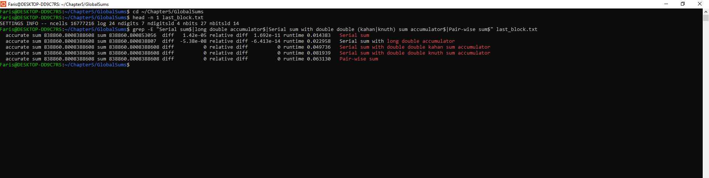

# Lab 05: Parallel Global Sum

In this lab I tested different ways of adding up a big array of numbers and compared how accurate they are and how long they take.

## What the code does

I used the `globalsums.c` program from the book's GlobalSums repository. It makes an array of doubles where the first half is a big value (0.1) and the second half is a really small value (about 1e-10). This is hard for a normal sum, because the small numbers get lost when the total is already big. The program adds the array with a lot of different methods, compares each answer to an accurate reference sum, and times each one. It does this for array sizes from 2^4 up to 2^24.

I looked at these five methods:

| Method | Function | Idea |
|---|---|---|
| Plain double | `do_sum` | Normal loop with one `double` variable (this is the baseline) |
| Long double | `do_ldsum` | Same loop but the sum variable is a `long double` (more bits) |
| Pairwise | `do_pair_sum` | Adds neighbours first, then adds those results, like a tree |
| Kahan | `do_kahan_sum` | Keeps a second variable with the small part that got lost, and adds it back |
| Knuth | `do_knuth_sum` | Works out the exact rounding error of every addition and adds all the errors at the end |

## How to build and run

    cd GlobalSums
    mkdir build && cd build
    cmake .. -DCMAKE_POLICY_VERSION_MINIMUM=3.5 -DCMAKE_BUILD_TYPE=Release \
        -DCMAKE_C_FLAGS="-march=native" -DCMAKE_CXX_FLAGS="-march=native"
    make
    ./globalsums > ../results_full.txt

I did not use `-ffast-math`. That flag lets the compiler change the order of the math, and it could remove the correction parts of Kahan and Knuth, which would ruin the results.

### Things I had to change to make it work

It did not work straight away on my computer (GCC 15 and a new CMake), so I changed a few things:

- `CMakeLists.txt`: I put quotes around the `${VECTOR_..._FLAGS}` variables in the `set_source_files_properties` lines. The variables were empty because the optional Fog vector class was not found, and CMake gave an error for the empty values. I also had to add `-DCMAKE_POLICY_VERSION_MINIMUM=3.5` because the file asks for a very old CMake version.
- I added `-march=native` so the optional AVX files could compile.
- `globalsums.c`: I turned off the call to `do_knuth_sum_gcc_v8` with `#if 0`, because it crashed with a segmentation fault. It is an extra vector version and not one of the five methods for this assignment.
- `globalsums.c`: I changed the loop to stop at `pow_of_two < 25`, so the biggest array is 2^24 numbers (about 128 MB). The original goes up to 2^30, which is too much memory for my machine.

## Results (ncells = 16,777,216 = 2^24)

The accurate reference sum is 838860.8008388608.

| Method | Absolute error | Relative error | Run time (s) |
|---|---|---|---|
| Double (baseline) | 1.42e-05 | 1.692e-11 | 0.014383 |
| Long double | -5.38e-08 | -6.413e-14 | 0.022958 |
| Pairwise | 0 | 0 | 0.063130 |
| Kahan | 0 | 0 | 0.049736 |
| Knuth | 0 | 0 | 0.081939 |

These numbers are from one run. The run times can change a bit every time you run it.

Google Sheet with the results: https://docs.google.com/spreadsheets/d/18eTI33TrntqgW036IPai2YIgMvrJeYPuBnU2B1cquQM/edit?usp=sharing

Screenshot of the terminal:

The full output of the program is in `results_full.txt` and the table for the spreadsheet is in `results.csv`.

An error of 0 here only means the answer matched the reference sum for this array size. It does not mean the method is perfect for every input.

## Why some methods are more accurate

A double only keeps 53 bits of precision. When the running sum is already big (like 400000) and I add a tiny number like 1e-10, most of the tiny number is below the last bit that can be stored, so it gets rounded away. Doing this millions of times adds up to a big error. That is why the plain double sum is the worst.

- **Long double:** on my x86 machine it has 64 bits of precision instead of 53, so less is lost on each addition. The error went down about 260 times, but not to zero, because the rounding still happens, just at a smaller size. It is also slower than double, because it uses the old x87 unit and not the faster SSE/AVX instructions.
- **Pairwise:** it adds numbers that are similar in size (small with small, then the results with each other), so not much is lost in each step. The error grows like O(log N) and not O(N). It is slower in this code because it needs an extra array and goes over the data several times.
- **Kahan:** after each addition it calculates `c = (t - sum) - y`, which is the part that was lost, and takes it away from the next number. So the lost bits are not forgotten, they get added back in later.
- **Knuth:** it calculates the exact rounding error of every addition, no matter which number is bigger, and keeps all the errors in a separate variable that is added at the end. It is the safest of them, but it is also the slowest because it needs about 6 operations for each number.

In my results the pairwise, Kahan and Knuth methods took about 3.5 to 6 times longer than the plain sum. So better accuracy costs extra time.

## How the global sum problem affects parallelization

A global sum is a reduction, which means a whole array gets reduced to one number, for example the total mass or energy in a simulation. The problem is that floating-point addition is not associative, so `(a + b) + c` can give a different answer than `a + (b + c)`. In a serial program the order is always the same, so you always get the same answer (even if it is a bit wrong). In a parallel program every thread or process adds its own part first, and then the partial sums are combined. The order depends on how many processors there are and on timing, so the answer can change between runs, between different numbers of processors, and compared to the serial answer. This is called non-reproducibility. It gets worse when the numbers have very different sizes, or when positive and negative numbers almost cancel each other out.

The usual fix is to sort the data and add it in a fixed order, but sorting is expensive and adding one by one in serial kills the parallelism, so it does not scale. The better idea is to use the more precise methods (Kahan, Knuth, pairwise, long double). They make the answer accurate enough that it hardly depends on the order any more. Then the additions can be reordered and split between threads, so the sum is still parallel and the result is much more reproducible. The price is some extra operations, but that is small compared to the time a real parallel program spends on memory and communication.
